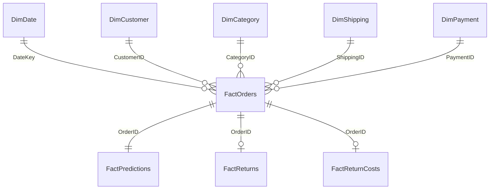

# RETURNSIGHT AI — Power BI Data Model & Star Schema Architecture

## 1. Schema Overview

The RETURNSIGHT AI analytical store follows the Kimball dimensional modeling standard:

- **Central Fact Table**: `FactOrders` (Grain: 1 row per customer order placed)
- **1-to-1 Subordinate Fact Tables**:
  - `FactPredictions` (Grain: 1 row per order with ML return probability and risk classification)
  - `FactReturns` (Grain: 1 row per confirmed return with reason, status, and turnaround days)
  - `FactReturnCosts` (Grain: 1 row per confirmed return with reverse freight, margin loss, and carbon footprint)
- **Dimension Tables**:
  - `DimCustomer` (Grain: 1 row per unique customer, analytical ID and behavioral features)
  - `DimCategory` (Grain: 1 row per merchandise category with risk tiers)
  - `DimShipping` (Grain: 1 row per carrier fulfillment method)
  - `DimPayment` (Grain: 1 row per checkout payment type)
  - `DimDate` (Grain: 1 row per calendar day with fiscal hierarchy)

---

## 2. Table Relationships Matrix

| From Table | From Column | To Table | To Column | Cardinality | Cross Filter Direction | Security / Active |
| :--- | :--- | :--- | :--- | :--- | :--- | :--- |
| `FactOrders` | `DateKey` | `DimDate` | `DateKey` | Many to One (*:1) | Single | Active |
| `FactOrders` | `CustomerID` | `DimCustomer` | `CustomerID` | Many to One (*:1) | Single | Active |
| `FactOrders` | `CategoryID` | `DimCategory` | `CategoryID` | Many to One (*:1) | Single | Active |
| `FactOrders` | `ShippingID` | `DimShipping` | `ShippingID` | Many to One (*:1) | Single | Active |
| `FactOrders` | `PaymentID` | `DimPayment` | `PaymentID` | Many to One (*:1) | Single | Active |
| `FactOrders` | `OrderID` | `FactPredictions` | `OrderID` | One to One (1:1) | Both | Active |
| `FactOrders` | `OrderID` | `FactReturns` | `OrderID` | One to One (1:1) | Both | Active |
| `FactOrders` | `OrderID` | `FactReturnCosts` | `OrderID` | One to One (1:1) | Both | Active |

---

## 3. Entity-Relationship Diagram

